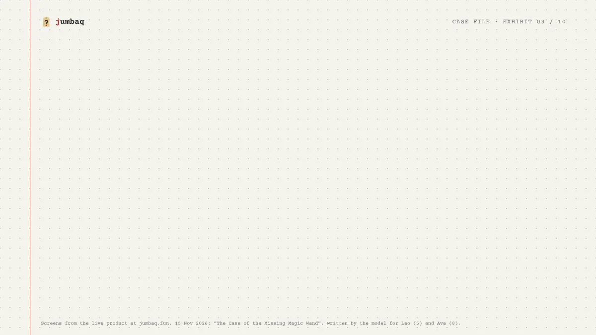
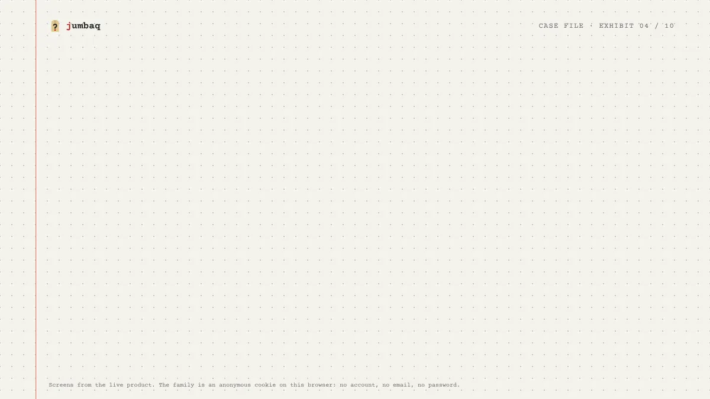
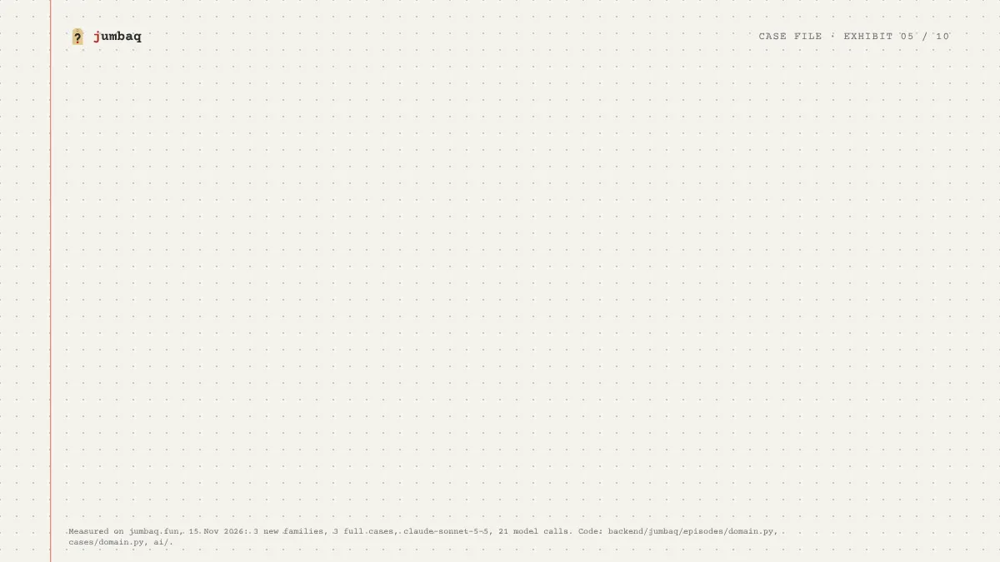

<p align="center">
  
</p>

<p align="center">
  <a href="https://jumbaq.fun"><b>jumbaq.fun</b></a> &nbsp;·&nbsp; no sign-up &nbsp;·&nbsp; the first case is free
  <br>
  <sub>Business Cup 2.0 · Entertainment track</sub>
</p>

*Jumbaq* is Kazakh for "riddle". A detective story for the evening that kids solve by searching their own home, read aloud by a parent from a phone.

Built in 24 hours. The user is a working parent in the U.S. with kids aged 4 to 10, who has twenty minutes before bedtime and nothing to do in them together.

## One evening

<p align="center">
  
</p>

The screens are from the live site: "The Case of the Missing Magic Wand", written by the model for Leo (5) and Ava (8).

## For reviewers

- **No login.** Open the site and press *Start tonight's case*. Setup takes one minute, with ready nicknames to tap.
- **Use your own home.** The case is written live by the model for the kids, rooms and objects you tick. Nothing is pre-written, except the built-in stories that play if the model is switched off or fails.
- **Demo controls.** A family waits until the next evening. Reviewers get a *Demo controls* block on the evening screen: *open the next evening now* and *skip this evening*. A skipped evening is still written by the model and played through the same rules.
- **Payments are in Stripe test mode.** The paywall appears when you ask for case 2. The test card is on the [Plans page](https://jumbaq.fun/plans): `4242 4242 4242 4242`, any future date, any CVC. *Manage or cancel subscription* opens the Stripe portal.
- **Start again.** *Start a new family* on the family page gives you a fresh case with other inputs.

## One case, all the way

<p align="center">
  
</p>

1. **Setup.** Kids' nicknames and ages, rooms, and a checklist of household objects.
2. **Five evenings.** Each evening has three steps:
   - *Answer.* The parent reads the story, and a riddle sends the kids to a real object ("I have hands but never clap"). Any answer is right, because it is their clock, and it is woven into the story.
   - *Decode.* The answer is the key to a cipher that hides a word of tonight's clue. The level follows the oldest kid's age: counting for under 6, a number code for 6 and 7, a letter shift from 8.
   - *Cross out.* The clue clears one of three suspects or points at one. The kids pick which.
3. **The accusation.** After evening 5 the kids name the culprit. A wrong guess is not a failure: the rank counts the tries.
4. **Rank and certificate**, printable, with the kids' names. Solved cases stay on the family page.
5. **The next case** needs the subscription: $7.99 a month for a new case every week.

## Inside

<p align="center">
  
</p>

**The model writes, code decides.** The case plan and every evening come from the model as strict JSON. Before a family sees anything, code checks the draft and sends it back with the reason if it fails:

- words a small child must not act on (a riddle that sends a kid outside, to the stove or to a socket);
- a story that gives away the clue the kids are about to decode;
- a riddle about an object the family did not tick, or one that asks for nothing;
- a plan that is not a fair mystery: every case has exactly one false trail in evening 1 or 2, the clues that point at the culprit come only in the last two evenings, and no clue clears the culprit;
- a title or a suspect name this family has already played.

If the model keeps failing or is switched off, a built-in plan and episode play, so a family is never stuck.

**What is not left to the model.** Code picks the object of each riddle, so a case uses the whole home and does not repeat an object. Code builds the cipher from the clue. Code sets the word budget of the read-aloud text by the age of the youngest kid.

**How the backend is built.** One module per subject (`families`, `cases`, `episodes`, `ai`, `billing`), each with the same layers: routers only speak HTTP, services hold the rules and import neither FastAPI nor SQLAlchemy, and a transaction exists only inside a unit of work. Side effects (planning a case, writing an episode) go through a transactional outbox to an arq worker, so the model is never called inside a request or with a transaction open. The module boundaries are checked by import-linter (19 contracts), and the tests run on a real PostgreSQL.

The rules for changing the code: [backend/AGENTS.md](backend/AGENTS.md) and [web/app/AGENTS.md](web/app/AGENTS.md).

## What a case costs

Measured on jumbaq.fun on 15 November 2026 (Almaty time): three new families each played a whole case, five evenings and the accusation, with `claude-sonnet-5-5`. The token counts are the ones the server records for every model call.

| | Family 1 (one kid, 5) | Family 2 (4 and 7) | Family 3 (6 and 9) |
|---|---|---|---|
| Model calls per case | 7 (two drafts refused) | 8 (two drafts refused) | 6 |
| Tokens, input / output | 23,363 / 5,019 | 27,645 / 5,823 | 20,140 / 7,229 |
| Cost of the case | $0.097 | $0.114 | $0.113 |
| Setup to the first evening | about 23 s | about 34 s | about 28 s |

At $2 and $10 per million input and output tokens, a whole case costs about 11 cents, and a subscriber who plays four cases a month costs about 43 cents. The refused drafts are the safety check at work: Family 2 got one draft with "outside" in a riddle and one that was not in English, and both were rewritten before anyone saw them. Family 1's evening 2 was refused twice ("outside", then "front door") and played the built-in evening instead. An evening now gets three tries before that happens.

## Dependencies

| What | Used for |
|---|---|
| Anthropic API (Claude Sonnet 5.5) | writing the case plan and the episodes |
| Stripe (test mode) | Checkout, the customer portal, webhooks |
| PostgreSQL 18 | all data, and the outbox |
| Redis 8 | the queue of the arq worker |
| FastAPI, SQLAlchemy 2, arq, Python 3.13 | the API and the worker |
| Next.js 16, React 19, RTK Query, Tailwind 4, next-intl | the web app |

## Run it

Needs Docker and [uv](https://docs.astral.sh/uv/).

```sh
make up      # postgres, redis, migrations, the API, the worker and the web app
make test    # all backend tests, on the test database of `make up`
make lint    # ruff and the import-linter contracts
```

The web app is on http://localhost:3000, the API on http://localhost:8000/api/v1 and its docs on http://localhost:8000/api/v1/docs. With no API key the stack plays the built-in stories; put `JUMBAQ_AI_PROVIDER=claude` and `JUMBAQ_AI_API_KEY` in `infra/.env` for real ones. No key or secret is in this repository.

## Repository

```
backend/   FastAPI API and arq worker (package jumbaq)
web/app/   Next.js web app at jumbaq.fun (standalone server)
infra/     the local Docker Compose stack and the database setup
deploy/    the server: its Docker Compose file and nginx behind Cloudflare
brand/     logo, colours, type and tokens for the web app
docs/      the pictures of this file (docs/images) and the script that builds the header
```

## Limitations

- There are no accounts. A family lives in a cookie on one browser for a year. A new phone, another browser or cleared browser data loses the family and its progress. For a subscriber that also means the subscription can't be managed from the new device.
- Stories are in English only.
- Payments run in Stripe test mode: no real money moves.
- There are no reminders. A family comes back because the case is open, not because we ping it.

## Roadmap

An optional email to save the family and move it to another device. Playing as a guest stays the default.

## Switching Claude on and off

The owner pays for the model, so the owner decides when it runs. The switch and the daily limit of model calls for all families together live in the database and are changed from the server, with no HTTP endpoint. While the model is off, every family still plays: new cases and episodes use the built-in ones. Until the switch is used for the first time, the settings decide (`JUMBAQ_AI_PROVIDER` and `JUMBAQ_AI_DAILY_CALL_LIMIT`).

On the server, in `/root/jumbaq` (where Luxen puts `docker-compose.yml`), as root:

```sh
docker compose exec api python -m jumbaq.ai.control status
docker compose exec api python -m jumbaq.ai.control on
docker compose exec api python -m jumbaq.ai.control limit 1000
docker compose exec api python -m jumbaq.ai.control off
```

`status` prints whether the model is on, the daily limit, today's calls and whether each value comes from the table or the settings. A change applies to the next model call, with no restart. `limit` stays when the model is switched off and on. On a laptop, `make ai-status`, `make ai-on`, `make ai-off` and `make ai-limit n=1000` do the same inside the running stack.

## Deploy

[Luxen](luxen.yaml) builds the backend and web images, pushes them to ghcr.io and deploys them to the server with `deploy/docker-compose.yml`. The web app is at https://jumbaq.fun, the API at https://api.jumbaq.fun. The server `.env` comes from `.env.example`.
